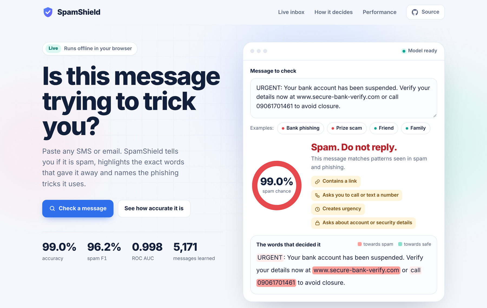
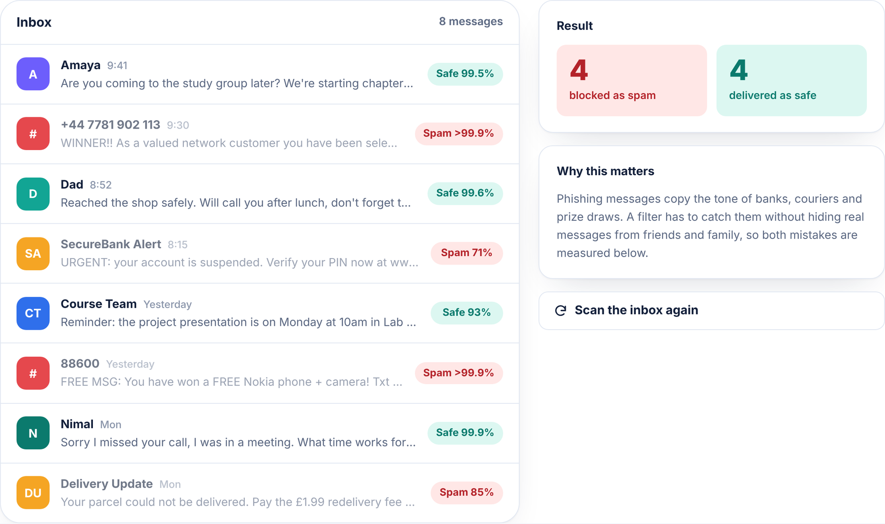
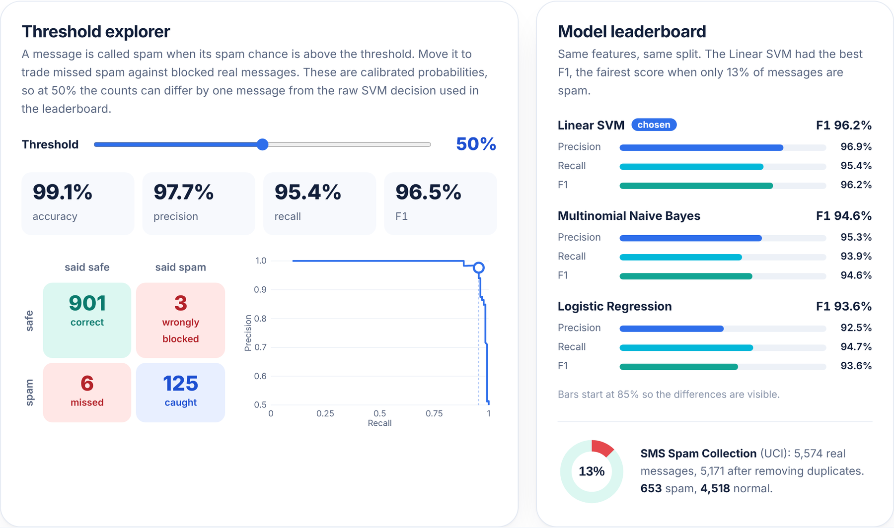
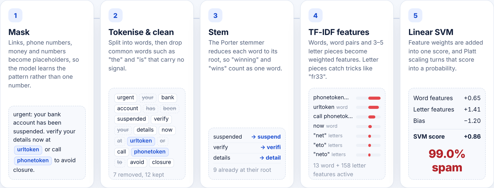
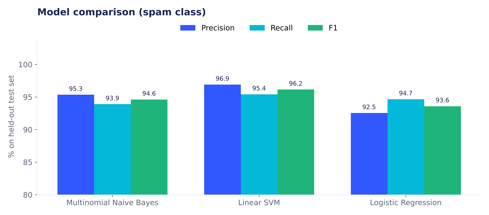
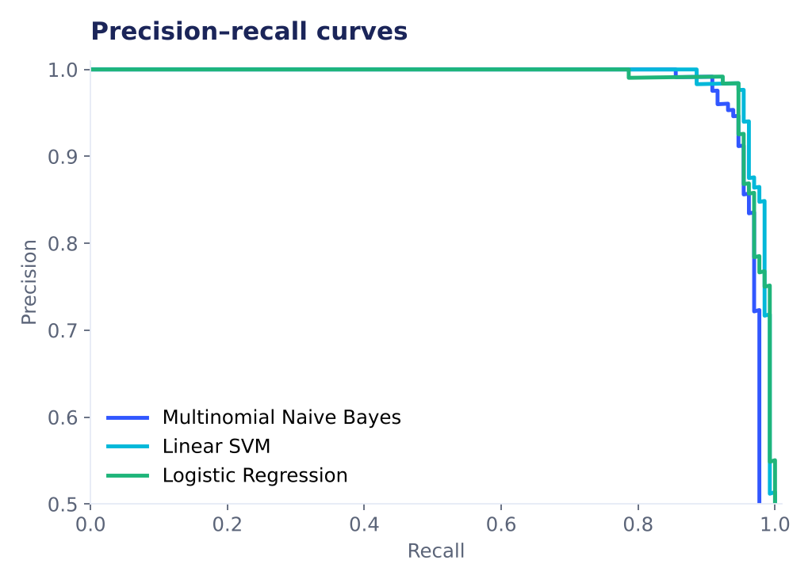
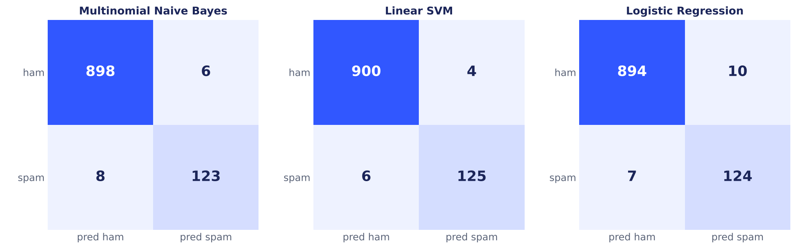
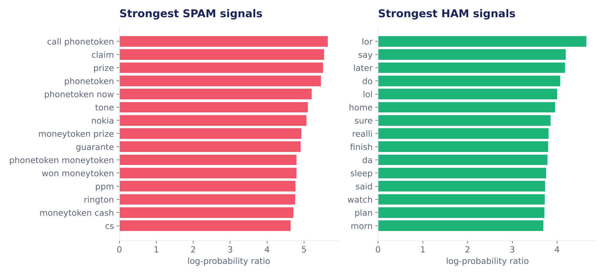

<div align="center">

# 🛡️ SpamShield — Explainable Spam & Phishing Detector

**NLP + machine learning that tells you if a message is spam, shows the exact words that gave it away, and names the phishing tricks it uses.**

[](https://devrisny.github.io/Pynexia_ML_Spam_Detection/)
[](https://github.com/DevRisny/Pynexia_ML_Spam_Detection/actions/workflows/ci.yml)


| Accuracy | Spam F1 | Precision | Recall | ROC AUC |
|:---:|:---:|:---:|:---:|:---:|
| **99.0%** | **96.2%** | **96.9%** | **95.4%** | **0.998** |

<sub>Linear SVM, measured once on 1,035 held-out messages the model never saw during training or tuning.</sub>

<a href="https://devrisny.github.io/Pynexia_ML_Spam_Detection/"></a>

</div>

---

## ✨ What makes it different

| | |
|---|---|
| 🔍 **Explainable** | Every prediction highlights the words that pushed it towards spam (red) or safe (green), using the model's real feature weights, not a guess. |
| 🎣 **Phishing red flags** | Flags links, "call this number", money/prize promises, urgency and requests for account details. |
| 🌐 **Runs in the browser** | The trained model is exported to JSON and re-implemented in JavaScript. Nothing you paste leaves your device, and no server is needed. |
| ✅ **Verified, not assumed** | The browser engine and the Python model were compared on all 5,171 messages: **5,171 / 5,171 identical decisions**. A test in CI keeps it that way. |
| 🎚️ **Threshold explorer** | The live site lets you move the decision threshold and watch precision, recall and the confusion matrix change on the real test set. |

<table>
<tr>
<td width="50%"><br><sub><b>Live inbox</b>: 8 messages scored one by one; click any to inspect it.</sub></td>
<td width="50%"><br><sub><b>Performance dashboard</b>: threshold explorer, PR curve and model leaderboard.</sub></td>
</tr>
</table>


<sub><b>How it decides</b>: the website follows your message through all five steps, live.</sub>

---

## 🧠 How it works

```
 raw message ─► 1 Mask ─► 2 Tokenise ─► 3 Stop words ─► 4 Stem ─► 5 TF-IDF ─► 6 Linear SVM ─► 7 Platt scaling ─► spam probability
               links, phones,   lower-case    "the", "is"     Porter    words + pairs     one score         0–100%
               money, numbers   a–z words     removed         stemmer   + 3–5 letter
               → placeholders                                           pieces
```

| Step | Why it matters |
|---|---|
| **Masking** | `09061701461` and `08452810075` both become `phonetoken`, so the model learns *"asks you to call a number"*, not one number. Same for links, money and plain numbers. |
| **Stop words + stemming** | Removes words with no signal and merges "win", "wins", "winning". Strong spam cues like *free*, *call* and *now* are deliberately kept. |
| **Word + character TF-IDF** | Word unigrams/bigrams capture phrases like *"claim prize"*; character 3–5-grams catch obfuscated spellings like *"fr33"*. |
| **Linear SVM** | Fast, strong on sparse text, and every weight can be read and explained. |
| **Platt scaling** | Turns the SVM score into a calibrated probability, learned on out-of-fold scores. |

## 📊 Results

Three models were tuned with `GridSearchCV` (stratified 5-fold, F1 scoring) on 80% of the data and evaluated **once** on the remaining 20%.

| Model | Accuracy | Precision | Recall | F1 | ROC AUC |
|---|---:|---:|---:|---:|---:|
| **Linear SVM** (chosen) | **99.03%** | **96.90%** | **95.42%** | **96.15%** | **0.998** |
| Multinomial Naive Bayes | 98.65% | 95.35% | 93.89% | 94.62% | 0.992 |
| Logistic Regression | 98.36% | 92.54% | 94.66% | 93.58% | 0.998 |

F1 is the deciding metric because spam is only 13% of messages: a model that always says "safe" would already score 87% accuracy.

<p align="center">
  
  
</p>
<p align="center"></p>
<p align="center"></p>

**Error analysis.** The SVM made 10 mistakes on 1,035 test messages (4 safe messages flagged, 6 spam missed). The missed spam is mostly soft promotions, quizzes and jokes with no link, phone number or prize, such as a fast-food competition or a ticket advert. The false alarms mention money or a short price ("your bill is £33.65"), which looks like spam to the model. All mistakes are saved in [`outputs/misclassified_examples.csv`](outputs/misclassified_examples.csv).

## 🗂️ Project structure

```
├── spam_detector.py          training, evaluation, charts, export and CLI
├── data/sms_spam.tsv         SMS Spam Collection (UCI), 5,574 messages
├── outputs/
│   ├── spam_model.joblib     final model (Linear SVM + Platt parameters)
│   ├── metrics.json          all test-set metrics
│   └── misclassified_examples.csv
├── docs/                     live website (GitHub Pages)
│   ├── index.html, styles.css, app.js
│   ├── spam-engine.js        the same pipeline in JavaScript
│   ├── model.json            exported vocabularies, IDF weights, SVM weights
│   └── images/               charts and screenshots
├── tests/test_spam_detector.py
└── .github/workflows/ci.yml  trains the model and runs the tests on every push
```

## ▶️ Run it yourself

```bash
pip install -r requirements.txt
python spam_detector.py train          # trains, evaluates, saves model + charts + website model
python spam_detector.py predict "URGENT! Your account is suspended. Verify at www.bank-login.com"
python -m pytest -q                    # 6 tests, including Python vs JavaScript parity
```

Example output:

```
[SPAM] spam probability 80.2%
  URGENT! Your account is suspended. Verify at www.bank-login.com
  red flags: contains a link; creates urgency; asks about account / security details
```

To view the website locally: `cd docs && python -m http.server`, then open http://localhost:8000.

## 📚 Dataset

[SMS Spam Collection](https://archive.ics.uci.edu/dataset/228/sms+spam+collection) (Almeida & Gómez Hidalgo, UCI Machine Learning Repository): 5,574 real English SMS messages labelled spam or ham. After decoding HTML entities and removing duplicates, 5,171 unique messages remain (653 spam, 4,518 ham). The task brief mentions email; SMS was used because it is a well-known, openly licensed, real-world spam corpus, and the same pipeline works on email text.

## 🛠️ Tech stack

Python · pandas · NumPy · scikit-learn · NLTK · matplotlib · joblib · JavaScript (vanilla) · HTML/CSS · pytest · GitHub Actions · GitHub Pages

---

<div align="center">

Built by **Junaideen Risny Suha** for the **Pynexia Machine Learning Internship**, Week 2 (Tree Classifiers, NLP Text Mining & Recommender Engines).

[LinkedIn](https://linkedin.com/in/risny-suha-8a6b66423) · [GitHub](https://github.com/DevRisny)

</div>
